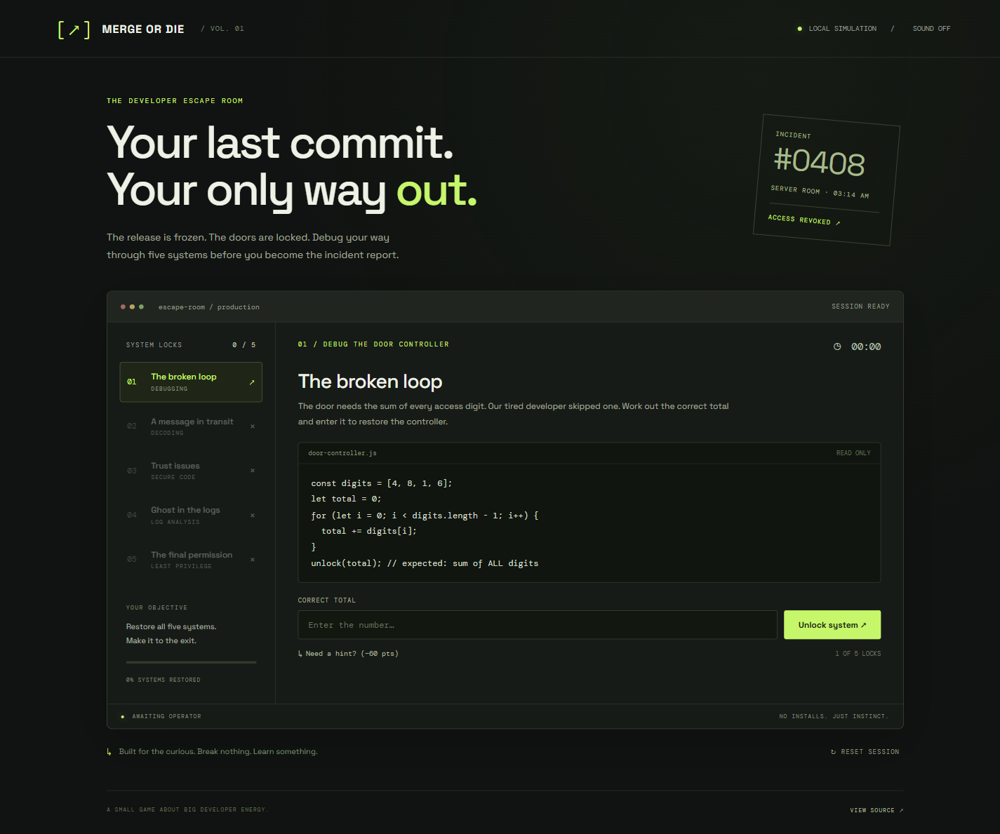

# Merge or Die ↗

**Five locks. One release. Your only way out is through the code.**

A small browser escape room about debugging and security. You are stuck in a server room before a release. Restore five systems to unlock the exit.



## Play locally

Requires Node.js 18 or newer. No packages to install.

```sh
git clone https://github.com/HizbullahS/developer-escape-room.git
cd developer-escape-room
npm start
```

Open **http://127.0.0.1:4173**. Use the local server rather than opening the HTML file directly, because the game uses JavaScript modules.

## Inside the room

| Lock | Skill |
| --- | --- |
| The broken loop | Spot an off-by-one error |
| A message in transit | Decode a Base64 message |
| Trust issues | Choose a safe SQL repair |
| Ghost in the logs | Trace a failure through logs |
| The final permission | Apply least privilege |

- Sequential unlocks, with completed puzzles available to revisit
- Hints and explanations after each solution
- Active-play timer that pauses while the tab is hidden or closed
- Progress saved in your browser, with a confirmed reset
- Final score and optional sound
- Responsive layout and keyboard-accessible controls

The timer starts on your first answer input or hint. Score starts at 1,000 and subtracts one point per active second, 60 per revealed hint, and 25 per incorrect answer. It never falls below zero. There is no time limit.

## Development

Plain HTML, CSS, and JavaScript. No framework or build step. Google Fonts supplies the typefaces; system fonts work if it is unavailable.

```sh
npm test
```

`puzzles.js` contains the puzzle data, answer checks, and scoring. `app.js` handles progression, saved state, and the interface. `server.js` serves an explicit allowlist of game files.

Browser checks cover a full playthrough, a wrong answer, hints and progress across reloads, completion, reset/cancel, and phone layout.

## Hosting

Any static host can serve `index.html`, `style.css`, `app.js`, and `puzzles.js` from the same folder. The game uses relative asset paths and works under a repository subpath, including GitHub Pages.

## About the simulation

This is a learning game. The puzzles run entirely in the browser, and their answers can be read in the source. No real accounts, credentials, or targets are involved. Browser storage holds only game progress; there is no leaderboard or backend.
